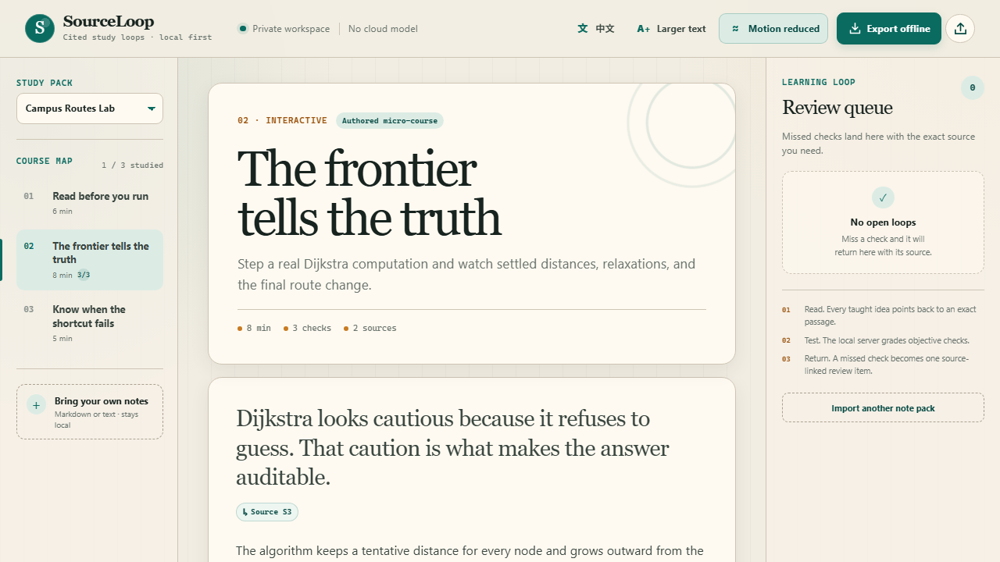
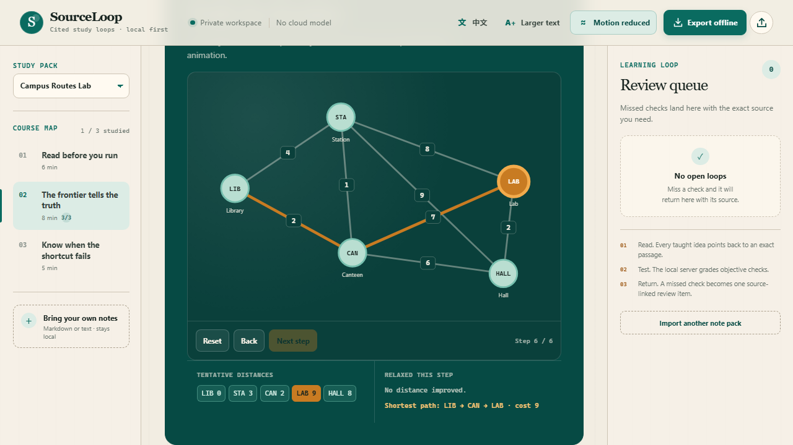

# SourceLoop

### Turn your notes into a cited, interactive study loop.

**BUHack 2.0 · Tertiary Track · EdTech**

SourceLoop is a local-first study workspace. A learner reads an authored explanation, follows its link to the exact source passage, steps a deterministic concept visual, answers server-graded checks, and returns every missed concept to a source-linked review queue. The complete pack can be exported as one self-contained HTML file and used offline.

This is an event-window, clean-room prototype. The repository was created from empty after the event opened, and it does not reuse a pre-event project, template, screenshot, or course fixture.



## What works

- A three-lesson bilingual micro-course, **Campus Routes Lab**, about weighted graphs and Dijkstra's shortest paths.
- English / Chinese switching, larger text, and reduced-motion controls.
- An exact source desk: every taught idea has a citation that expands to the original passage.
- A real Dijkstra trace computed by the local Python server. Step, back, and reset controls update settled nodes, tentative distances, relaxations, and the final `LIB → CAN → LAB` path with cost `9`.
- Objective practice graded on the server, with answers, reasoning, and source links returned only after submission.
- A deduplicated review queue: a wrong answer creates one source-linked item; a correct retry resolves the same item.
- Local Markdown/plain-text import that creates literal quote and source-location checks rather than invented explanations.
- One-file offline HTML export. The exported file grades practice and runs its graph / language controls with no server.
- Responsive layouts verified at 1440, 390, and 320 CSS pixels, with visible focus and keyboard-operable controls.



## Run it

Requirements: Windows and Python 3.11 or newer. The application uses only the Python standard library.

Double-click `START_WINDOWS.cmd`, or run:

```powershell
cd F:\Hackathon-2026\BUHack-Cleanroom-20261113
python -m sourceloop --host 127.0.0.1 --port 8765 --open
```

Open `http://127.0.0.1:8765/` if the browser does not open automatically. Stop the server with `Ctrl+C`.

Runtime data is written under `runtime/`:

```text
runtime/
  database/sourceloop.sqlite3
  exports/
  uploads/
  cache/
  logs/
```

The server binds to loopback by default and does not call an external model or service.

## Demo video

The local demo is `evidence/SourceLoop-demo.mp4`. It is **2:45**, captured from the live application, and shows the source desk, bilingual switching, real Dijkstra stepping, wrong-answer review, correct retry, Markdown import, and offline `file://` export. A public video URL is pending an authenticated upload.

## Verify it

Python unit and integration tests:

```powershell
python -m unittest discover -s tests -p "test_*.py" -v
```

Browser acceptance tests:

```powershell
npm ci
npx playwright install chromium
npm run test:e2e
```

The browser runner starts a separate server on port `8766`, uses its own `runtime/e2e` database, writes screenshots and a report under `evidence/`, and stops the server afterwards.

The acceptance suite covers:

- desktop, 390px, and 320px layout;
- language, text-size, and motion preferences;
- all three lessons;
- real graph stepping and the final shortest path;
- a wrong answer, source-backed feedback, and review creation;
- correct retry and review resolution;
- local Markdown import;
- a downloaded offline pack;
- offline `file://` operation and local grading;
- console errors and horizontal overflow.

See `TEST_RESULTS.md` for the latest recorded run.

## Why this is a clean-room entry

The available pre-event project could not be reused under the event rule verified for this submission. SourceLoop therefore starts from the learner problem rather than from old source: students need a reliable return path from an explanation, through practice, back to the exact course material.

That constraint shaped the product:

- no shared Git history or imported source tree;
- no copied course content or screenshots;
- a new SQLite database and isolated runtime directory;
- deterministic, observable computation instead of a cloud model;
- a narrow promise that can be inspected rather than an unsupported learning-gain claim.

Details and hashes are recorded in `CLEAN_ROOM_RECORD.md`, `SOURCE_MAP.md`, and `ISOLATION_REPORT.md`.

## Architecture

```text
Browser (HTML + CSS + vanilla JS)
  │
  ├── loopback JSON API
  │     ├── authored content validation and public-payload redaction
  │     ├── deterministic Dijkstra trace
  │     ├── SQLite attempts and deduplicated review queue
  │     └── self-contained HTML export
  │
  └── exported HTML
        └── embedded course, answers, sources, CSS, JS, and computed trace
```

Core files:

| Path | Responsibility |
| --- | --- |
| `sourceloop/app.py` | loopback HTTP server, routing, request validation, security headers |
| `sourceloop/content.py` | content validation, public redaction, local note import |
| `sourceloop/graph.py` | deterministic non-negative shortest-path trace |
| `sourceloop/store.py` | isolated SQLite attempts, imports, and review items |
| `sourceloop/export.py` | one-file offline study pack |
| `sourceloop/static/` | responsive learning workspace |
| `tests/` | unit, integration, and browser acceptance tests |

## API

| Method | Path | Purpose |
| --- | --- | --- |
| `GET` | `/api/health` | process and database readiness |
| `GET` | `/api/bootstrap` | pack summaries and default pack |
| `GET` | `/api/packs/{id}` | public pack without answers or explanations |
| `POST` | `/api/attempts` | server-side grading for one lesson |
| `GET` | `/api/review` | open source-linked review items |
| `POST` | `/api/review/{id}/resolve` | resolve one review item |
| `POST` | `/api/import` | turn Markdown/plain text into a local pack |
| `GET` | `/api/export/{id}?lang=en\|zh` | one-file offline study pack |

Mutating requests accept JSON only. The request body limit is 256 KiB. SQL uses parameters. The browser renders external text through DOM text APIs. The served app uses a restrictive content security policy and no permissive CORS headers.

## Design boundaries

- The included course is authored for this prototype. It is not an official university assessment.
- Imported notes remain the source of truth. The import flow creates exact retrieval checks; it does not generate new factual explanations.
- The offline file contains a fixed answer key for local study. It is not a secure exam client.
- The app does not claim measured learning gains.
- Accounts, cloud sync, PDF/OCR import, and additional visual models are outside this MVP.

See `KNOWN_LIMITATIONS.md` for the full boundary list.

## Repository

Public source: [github.com/xiao18825501901-rgb/sourceloop-buhack](https://github.com/xiao18825501901-rgb/sourceloop-buhack)

Event window: **2026-11-13 10:00 HKT → 2026-11-15 10:00 HKT**

## License

MIT. See `LICENSE` and `THIRD_PARTY_LICENSES.md`.
